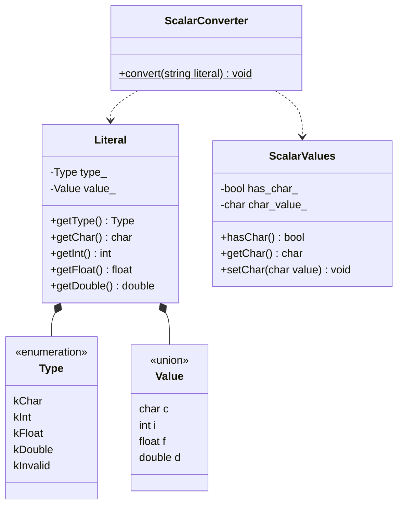

# ex00: Conversion of scalar types

`ScalarConverter::convert` は、文字列を4つの段階に分けて処理する。
各段階は、変更される理由が1つになるように分けてある。

## データの流れ

`string → Literal → ScalarValues → string → std::cout`

| 段階 | 役割 | 変更される理由 |
|---|---|---|
| `parse` | リテラルの型を判別し、その型の値にする | 受け付ける入力のルールが変わる |
| `cast` | 残り3つの型へ変換し、変換できるかを判定する | 型同士の変換ルールが変わる |
| `format` | 4つの値を出力用の文字列にする | 出力の見た目が変わる |
| `convert` | 上の3つを順に呼び、結果を書き出す | 入出力の経路が変わる |

## 設計の方針

- **単一責任の原則**: 上の表の通り、各段階が変更される理由は1つだけ。たとえば出力の書式を変えるときに直すのは `format` だけで、`parse` と `cast` には触れない。
- **高い凝集度**: 同じ種類のルールは1か所に集める。「char に収まるか」「nan は整数にできない」といった判定は、変換元の型が何であってもすべて `cast` の中にある。
- **低い結合度**: `parse`、`cast`、`format` は互いを呼ばず、`Literal` と `ScalarValues` だけを介してつながる。3つすべてを知っているのは `convert` だけ。`Literal` と `ScalarValues` も互いを知らない。

## クラス図

`ScalarValues` は char の分だけを描いている。int、float、double も同じ形で持つ。
`parse`、`cast`、`format` は `ScalarConverter` のメンバではなく、`ScalarConverter.cpp` の中だけで使う static 関数なので、クラス図には現れない。
